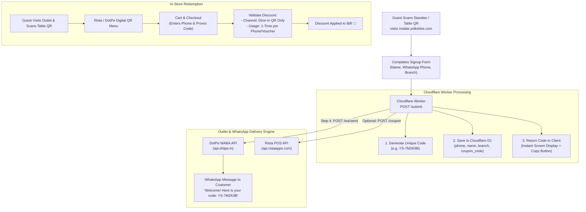

# 🎟️ Yolkshire Signup Incentive & DotPe / Rista WhatsApp Integration Specification

> [!IMPORTANT]
> ## 🤖 MANDATORY HANDOVER DIRECTIVE FOR FUTURE AGENTS
> **STOP & READ BEFORE WRITING ANY CODE:**
> You are inheriting this task to implement the Yolkshire WhatsApp marketing signup incentive.
> **DO NOT start modifying `src/worker.js`, running database migrations, or altering `public/index.html` until you have asked the user and received explicit answers to ALL the questions in [Section 6: Implementation Readiness Questionnaire](#-6-implementation-readiness-questionnaire).**
>
> **Mandatory Workflow for Handover Agent:**
> 1. **Review Context:** Read this entire document, the attached API documentation in [`docs/DOTPE WHATSAPP APIs.pdf`](DOTPE%20WHATSAPP%20APIs.pdf), and the Rista Swagger spec at `https://ristaapps.com/api/documentation/swagger.json`.
> 2. **Ask Questions:** Present the unanswered questions from Section 6 to the user and await their explicit responses.
> 3. **Record Decisions:** Update the [Decision Log](#decision-log) at the end of this file with their selected parameters.
> 4. **Update Plan:** Formulate the step-by-step implementation plan reflecting their chosen architecture (Option A, B, or C).
> 5. **Execute & Verify:** Only after approval, perform schema migration, worker updates, UI enhancements, and end-to-end verification.

---

> **Status:** Architecture Ready — Pending User Questionnaire Answers  
> **Date:** October 19, 2026  
> **App:** `insider.yolkshire.com` (Cloudflare Workers + D1 Database)  
> **Target Integration:** DotPe WhatsApp Business API (WABA) + Rista POS (by DotPe)  

---

## 📌 1. Executive Summary

To boost conversion rates on the Yolkshire WhatsApp opt-in web app, we are introducing an automated signup incentive:
1. When a guest signs up at **`insider.yolkshire.com`**, a unique single-use discount code is generated.
2. The contact and discount code are immediately synced to **DotPe WABA**, triggering an automated branded WhatsApp message to the customer's phone.
3. The customer can redeem this discount code **only when placing a Dine-In QR order** at any physical Yolkshire outlet.
4. The discount code is strictly locked out of aggregator platforms (Swiggy, Zomato) and direct delivery channels, and is valid for a single redemption only.

---

## 🏗️ 2. System Architecture Flow



---

## 📚 3. Official API References & Discovered Specifications

### A. Rista POS Platform API (by DotPe)
* **Official Documentation Portal:** [https://ristaapps.com/api/documentation/](https://ristaapps.com/api/documentation/)
* **Swagger / OpenAPI JSON Specification:** [https://ristaapps.com/api/documentation/swagger.json](https://ristaapps.com/api/documentation/swagger.json)
* **Base URL:** `https://api.ristaapps.com/v1`
* **Authentication Method:**
  * Header `x-api-key`: Admin API Key (generated from Rista Access Menu)
  * Header `x-api-token`: Dynamic JSON Web Token (JWT) signed with the business Secret Key using HMAC-SHA256 (`HS256`).
  * JWT Payload structure:
    ```json
    {
      "iss": "YOUR_API_KEY",
      "iat": 1729339200,
      "jti": "random_nonce_or_uuid"
    }
    ```

#### Discovered Relevant Rista Endpoints:
1. **`POST /coupon`**: Creates a coupon code within your business account.
   * **Required fields**: `couponProvider`, `couponCode`, `discounts` (array containing `discountCode`), `expiryDate`.
   * **Customer mapping**: Accepts `customer.phoneNumber` and `customer.firstName`.
2. **`POST /coupon/verify`**: Verifies whether a coupon is valid for a specific branch, phone number, and channel (`branchCode`, `channelName`, `phoneNumber`).
3. **`POST /customer`**: Upserts customer demographic info into Rista CRM.

---

### B. DotPe WhatsApp Business API (WABA)
* **Source Reference:** [`docs/DOTPE WHATSAPP APIs.pdf`](DOTPE%20WHATSAPP%20APIs.pdf) (in project repository)
* **Base URL:** `https://api.dotpe.in/api/comm/public/enterprise/v1`
* **Authentication Header:** `Dotpe-Api-Key: dpmat-<your-token>`
* **Content-Type:** `application/json`

#### Discovered Relevant DotPe Endpoints:
1. **`POST /wa/send` (Template-Based Message Dispatch)**:
   * Used to dispatch pre-approved WhatsApp marketing/utility templates to customers.
   * **Payload Specification:**
     ```json
     {
       "merchantId": 5618,
       "template": {
         "name": "yolkshire_welcome_coupon",
         "language": "en"
       },
       "wabaNumber": "91XXXXXXXXXX",
       "recipients": [
         "919876543210"
       ],
       "source": "crm",
       "clientRefId": "YS_SUB_1729339200",
       "params": {
         "header": "optional_header_media_or_text",
         "body": [
           "Customer_First_Name",
           "UNIQUE_CODE"
         ]
       }
     }
     ```
   * **Successful Response (`200 OK`)**:
     ```json
     {
       "jobId": 12796,
       "status": true
     }
     ```
2. **`GET /templates?status=APPROVED`**: Fetches all currently active, approved WABA templates and their variable placeholders.
3. **Webhook Subscriptions**: DotPe supports webhooks for delivery receipts (`dlr`: sent, delivered, read, failed) and `inbound_messages`.

---

## 🛡️ 4. Enforcing "QR-Only at Outlet" (Not Swiggy / Zomato / Direct Delivery)

A critical requirement is that this incentive can **only be redeemed on physical Dine-In QR table orders**:

1. **Third-Party Aggregators (Swiggy / Zomato)**:
   * Swiggy and Zomato run on their own native cart and checkout engines.
   * Promo codes entered on Swiggy/Zomato are validated against the aggregator's offer database. DotPe/Rista internal coupons simply do not exist on Swiggy or Zomato, making it impossible for customers to use them there.
2. **Direct Delivery / Takeaway vs. Dine-In Table QR in Rista**:
   * In the Rista Management Console under **Marketing / Promotions > Create Promotion**:
     * Set **Channel / Order Type** = **Dine-In (QR Table Ordering)** only.
     * Deselect **Delivery** and **Takeaway**.
   * When customers scan the QR standee placed on the restaurant table, Rista initiates a `Dine-In` session with table number parameters. Any order placed from this session allows the code; any direct delivery order via web will reject the code.

---

## ⚖️ 5. Implementation Options & Trade-Offs

We have identified **three viable implementation patterns** for generating and validating the incentive:

---

### Option A: The Full Real-Time Sync (Rista API + DotPe WABA) ⭐
* **How it works:**
  1. Customer submits signup form on `insider.yolkshire.com`.
  2. Cloudflare Worker generates a random unique string (e.g. `YS-7M9K2P`).
  3. Worker calls Rista `POST /coupon`, registering `YS-7M9K2P` linked to the base Dine-In discount and customer's phone number.
  4. Worker calls DotPe `POST /wa/send` passing the customer's name and `YS-7M9K2P`.
  5. Worker records the signup, code, and DotPe `jobId` in D1.
* **Trade-offs:**
  * ✅ **Pros:** 100% unique alphanumeric codes per person. Completely automated without manual CSV handling. Real-time activation.
  * ⚠️ **Cons:** Requires Rista Sales Enterprise + API license with active API Key & Secret Key. Involves two outbound API requests during submission (can be offloaded to `ctx.waitUntil` to maintain sub-second UI response).

---

### Option B: Pre-Generated Voucher Batch Pool (D1 Pool + DotPe WABA)
* **How it works:**
  1. In the Rista Console, export a batch of 2,000–5,000 single-use vouchers for the Dine-In QR promotion.
  2. Load these codes into a `voucher_pool` table in Cloudflare D1.
  3. On customer signup:
     * D1 atomically claims the next unassigned voucher (`UPDATE voucher_pool SET assigned_to = phone WHERE id = ... RETURNING code`).
     * Worker calls DotPe `POST /wa/send` to deliver the voucher to the customer's WhatsApp.
* **Trade-offs:**
  * ✅ **Pros:** Zero dependency on the Rista API during form submission. Instantaneous response time (<50ms). Each customer receives a truly unique voucher.
  * ⚠️ **Cons:** Requires batch uploading vouchers to D1 whenever the pool gets low (an admin alert can be added to the dashboard).

---

### Option C: Branded Campaign Code with "1-Redemption-Per-Phone" Rule in Rista
* **How it works:**
  1. In Rista POS, create a promotion with a static memorable code (e.g. `EGGSCLUSIVE` or `YOLKWELCOME`).
  2. Configure Rista's rules:
     * **Applicable Order Mode:** Dine-In QR only.
     * **Redemption Limit:** Strictly **1 use per customer mobile number**.
  3. On customer signup:
     * Worker assigns `EGGSCLUSIVE` to the customer record in D1.
     * Worker calls DotPe `POST /wa/send` with template:
       > *"Hi {{1}}, your exclusive welcome offer is now unlocked! Use code **EGGSCLUSIVE** on your table QR order. Valid for 1-time use on your number."*
  4. When the guest orders at the table, Rista checks the guest's mobile number against past orders. If the number has already redeemed `EGGSCLUSIVE`, the discount is rejected.
* **Trade-offs:**
  * ✅ **Pros:** Easiest and most reliable to roll out immediately. No Rista API key needed. Customers find words like `EGGSCLUSIVE` easier to remember than random strings.
  * ⚠️ **Cons:** The code text itself is not random/unique, though the **redemption entitlement is strictly 1-time per customer**.

---

## ❓ 6. Implementation Readiness Questionnaire

> **NOTE TO USER / FUTURE AGENTS:** The following questions must be answered to select the exact architecture and finalize code implementation.

### Q1. Architectural Option Selection
Which implementation approach should we implement?
- [ ] **Option A (Real-time dynamic vouchers via Rista API + DotPe WABA)**: Fully automated unique codes generated per signup and registered in Rista POS. *(Requires Rista API Key + Secret Key)*.
- [ ] **Option B (Pre-generated voucher pool in D1 + DotPe WABA)**: Pre-generate a batch of vouchers in Rista, load them into Cloudflare D1, and dispatch them one-by-one via DotPe.
- [ ] **Option C (Branded campaign code + 1-use-per-phone rule in Rista + DotPe WABA)**: Use a memorable code (e.g. `EGGSCLUSIVE`) with Rista strictly enforcing 1-use per customer phone on table QR.

### Q2. Commercial Discount Offer Details
- **Discount Type & Value:** What is the discount offer? (e.g. *10% off*, *15% off*, *Flat ₹50 off*, *Flat ₹100 off*, or *Complimentary item*)?
- **Minimum Order Value (MOV):** Is there a minimum bill amount required to redeem? (e.g. *None*, *₹300*, *₹500*)?
- **Maximum Discount Cap:** If percentage-based, what is the maximum discount cap? (e.g. *₹100 max*)?
- **Validity Duration:** How many days should the code remain valid after signup? (e.g. *15 days*, *30 days*, *60 days*)?

### Q3. DotPe WABA Credentials & Setup
- **DotPe Merchant ID:** What is your DotPe Merchant ID? (visible in DotPe URL/Dashboard header, e.g. `5618`).
- **DotPe WABA Sending Number:** What is the registered WhatsApp phone number used by DotPe to send messages? (Format: `91XXXXXXXXXX`).
- **DotPe API Key:** Have you generated the API key from DotPe (`dpmat-...`)? *(Will be stored in Cloudflare via `wrangler secret put DOTPE_API_KEY`)*.
- **WABA Template Name:** What is the name of the approved template on your DotPe panel? (If none exists yet, please specify if you would like us to draft the text for you to submit to DotPe).
- **Template Variables:** How are parameters structured in your template? (e.g., `{{1}}` = Name, `{{2}}` = Code, `{{3}}` = Expiry Date).

### Q4. Rista POS Promotion Setup
- **Base Discount Code Name:** What is the exact discount name/code created in Rista POS? (e.g. `DINEIN_WELCOME` or `EGGSCLUSIVE`).
- **Channel Restriction:** Can you confirm that the discount has been set to **Dine-In QR** only (with Delivery and Takeaway disabled) in Rista Console?
- **Rista API Credentials (if Option A chosen):** Do you have the **API Key** and **Secret Key** from Rista Console > **Access Menu**?

### Q5. Branch Applicability
- Is this incentive applicable across **all Yolkshire outlets** (Kothrud, Aundh, Bavdhan, Salunkhe Vihar, etc.) or limited to specific outlets?

### Q6. User Interface Copy & Post-Signup Experience
- Should the coupon code be displayed **immediately on the web screen** upon signup with a "Copy Code" button, in addition to being sent via WhatsApp? *(Recommended: Yes, for instant in-restaurant conversion)*.

---

## 📝 Decision Log

*(To be filled in by the agent once user provides answers)*

| Parameter | Decision / Value | Confirmed By | Date |
|---|---|---|---|
| **Chosen Option** | *Pending (A / B / C)* | | |
| **Discount Rule** | *Pending (e.g. 10% off up to ₹100)* | | |
| **Validity Days** | *Pending (e.g. 30 days)* | | |
| **DotPe Merchant ID** | *Pending* | | |
| **DotPe WABA Number** | *Pending* | | |
| **DotPe Template Name**| *Pending* | | |
| **Rista Base Discount**| *Pending* | | |
| **Screen Display** | *Yes (Recommended)* | | |

---

## 🛠️ Technical Implementation Checklist (For Next Agent)

Once the Decision Log is completed, follow these execution steps:

- [ ] **Step 1:** Run D1 database migration (`ALTER TABLE signups ADD COLUMN coupon_code ...`).
- [ ] **Step 2:** Configure Cloudflare secrets using `npx wrangler secret put`.
- [ ] **Step 3:** Implement coupon generator and DotPe dispatch helper in `src/worker.js`.
- [ ] **Step 4:** Integrate non-blocking background dispatch using `ctx.waitUntil(...)`.
- [ ] **Step 5:** Update `public/index.html` to render the coupon card with copy-to-clipboard functionality on success.
- [ ] **Step 6:** Update `public/admin.html` to display the coupon code and include it in CSV exports.
- [ ] **Step 7:** Test locally using `npx wrangler dev`.
- [ ] **Step 8:** Commit, push to `main` for automated GitHub Actions deployment.
